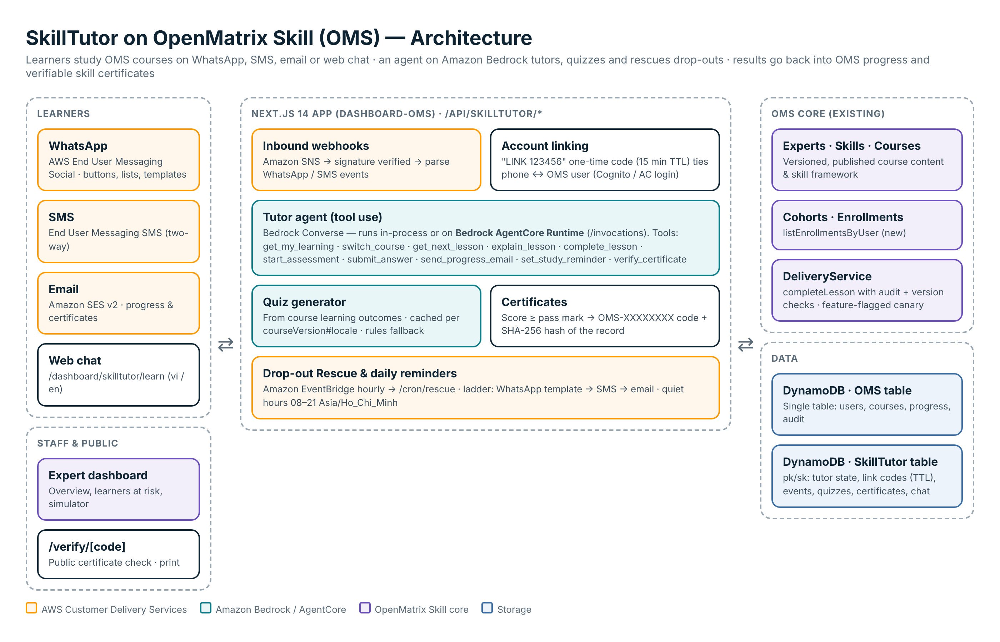

# SkillTutor for OpenMatrix Skill - V0.6.4

**An AI tutor that teaches real courses in 5-minute lessons inside WhatsApp, writes progress back into the course and issues skill certificates anyone can verify.**

Built by **OLYM3 Co., Ltd.** for the **AWS Communication Developer Services (CDS) Agentic AI Partner Hackathon**, on top of **OpenMatrix Skill (OMS)**, OLYM3's skills-and-courses platform.

| | |
| --- | --- |
| 🌐 Live app | https://skilltutor.openmatrixskill.com |
| 💻 Source code | https://github.com/thanhnhaweb3/SkillTutor-for-OpenMatrixSkill |
| ✅ Verify a certificate | https://skilltutor.openmatrixskill.com/verify |
| 🎬 Demo video (2:42) | [`docs/video/SkillTutor-demo-v1.mp4`](docs/video/SkillTutor-demo-v1.mp4) · storyboard: [`docs/video/README.md`](docs/video/README.md) |
| 🖼️ Image gallery | [`docs/gallery/`](docs/gallery/) · [PDF](docs/SkillTutor-image-gallery.pdf) |
| 🚀 Deploy guide | [`docs/DEPLOY-VERCEL.md`](docs/DEPLOY-VERCEL.md) |

Version **0.6.4** · Next.js 14 · TypeScript · AWS (Sydney, `ap-southeast-2`)



---

## Contents

1. [Why SkillTutor](#why-skilltutor)
2. [What's new in 0.6.4](#whats-new-in-064)
3. [Features](#features)
4. [AWS services used](#aws-services-used)
5. [Architecture](#architecture)
6. [Quick start (demo mode, no AWS needed)](#quick-start-demo-mode-no-aws-needed)
7. [Production setup](#production-setup)
8. [Scripts](#scripts)
9. [Routes](#routes)
10. [Project structure](#project-structure)
11. [Tests](#tests)
12. [The hackathon](#the-hackathon)
13. [About OLYM3 and the team](#about-olym3-and-the-team)
14. [License](#license)

---

## Why SkillTutor

Most office workers who start an online course never finish it. They don't lack motivation. They lack a moment when opening a course portal feels easier than opening a chat app.

SkillTutor brings each lesson to the app learners already open dozens of times a day. The course, the progress record and the certificate stay in OpenMatrix Skill, so the learning still counts. An Expert publishes a course once; learners take it in WhatsApp, in the browser, or both.

---

## What's new in 0.6.4

- **Bilingual courses (English / Tiếng Việt).** A course manifest can pair both languages in every text field. The web pages and the tutor (WhatsApp, Learn on the web, quiz, emails, reminders) show only the half for the selected language and switch instantly with the EN/VI selector. Two new 45-minute bilingual courses ship with the app.
- **Expert team / hackathon judges.** On *Approve learners*, an Expert admin can approve any signed-in account as Expert staff by email (default role: reviewer) and remove it again.
- **Featured courses layout.** Two courses per row; with more than two, the list scrolls inside its own box. The old *Explore by topic* block was removed.
- **Fixes.** The cohort picker on *Approve learners* no longer overflows the card with long course names; live course cards show the course in the visitor's language.
- **OMS limits.** Lesson summaries may be up to 4,000 characters (was 2,000) so a lesson can hold both languages.

---

## Features

### For learners

- **Course catalogue on the landing page.** The live cohorts of the Experts in `SKILLTUTOR_PUBLIC_EXPERT_IDS` are listed with lesson count, time to complete and the skills they certify, two per row; with more than two courses the list scrolls. Each card shows the visitor's status: *sign in*, *request to join*, *waiting for approval*, *enrolled – continue*.
- **Your account at a glance.** Signed-in visitors see a welcome panel with their WhatsApp link status, enrolled courses with progress bars, and certificate count.
- **Link WhatsApp with one message.** Get a one-time code (valid 15 minutes) and send `LINK 123456` to the SkillTutor number. Because the message arrives from your phone, it proves you own the number: no app, no OTP form.
- **5-minute lessons in WhatsApp.**
  - Lessons arrive with reply buttons: *Done ✓ / Explain more / My progress*.
  - *Done* writes progress straight into the OMS course.
  - Ask for an explanation, check progress, switch course, or type "remind me at 20:00" for a daily reminder.
- **Certification quiz.** Questions come from the course's learning outcomes, with button/list answers. Grading is done by code, not by the model.
- **Verifiable certificates.**
  - Passing issues `OMS-XXXXXXXX` with the skills and levels earned, a printable certificate page, and a SHA-256 hash of the record.
  - The certificate is also emailed.
- **My courses.** Every enrolled course with a progress bar and each lesson, grouped by module and marked ✓ completed, ▶ up next or ○ not started. One click continues on the web (the tutor switches to that course and sends the next lesson) or on WhatsApp; finished courses offer *Take the test* or *View certificate*.
- **Learn on the web.** The same WhatsApp conversation continues in the browser, with the same history and the same daily quota.
- **SkillTutor AI.**
  - A floating assistant on every page, answering open questions with **Claude Haiku 4.5 on Amazon Bedrock** and the learner's own course data (tool use).
  - It is a separate conversation from WhatsApp.
  - It has a quota of **10 AI messages per learner per day**.
- **Bilingual.** Vietnamese and English for the UI and the tutor (default English). Switch with the EN/VI selector, or type "English" or "Tiếng Việt" to the tutor.
- **Bilingual course content.** Courses written in both languages show only the selected language everywhere: landing cards, My courses, lessons, quiz questions, certificates and reminders. Course cards also show the title in the other language underneath. Single-language courses are shown unchanged.
- **Profile and settings.** Interface language, country of residence and connected accounts. Dark mode on every page.

### For Experts and staff

- **Learner approval.** Pick a cohort, share its join link, then approve or reject join requests. You can also add learners directly by email; they are enrolled and notified.
- **Expert team (e.g. hackathon judges).** On the same page, enter an email and pick a role to approve an account as Expert staff:
  - roles: reviewer (default, for judges: view and approve skills and courses), auditor (read-only), instructor, curriculum manager, expert admin;
  - **Remove** takes the staff roles away; someone who is also a learner keeps learning, anyone else is suspended and can be approved again later;
  - you cannot remove yourself, a platform admin or the last Expert admin, and only Expert admins can grant Expert admin;
  - the person must have signed in to OpenMatrix Skill once. Every change goes through the OMS membership service and is audited.
- **Roster.** Each learner's progress, channel, certificate and enrolment date.
- **Overview.** Linked learners, lessons delivered, pass rate, certificates and nudges, plus learners at risk of dropping out.
- **Drop-out rescue.** Inactive learners get a reminder ladder:
  - day 3 on WhatsApp (an approved template outside the 24-hour window);
  - day 5 by SMS;
  - day 7 by email with a comeback plan.

  Quiet hours run 21:00–08:00 Asia/Ho_Chi_Minh. It runs hourly via EventBridge Scheduler, or on demand.
- **WhatsApp diagnostics.** Send a test message and see AWS acceptance and Meta delivery receipts (sent / delivered / read / failed, with error codes).
- **Simulator.** A dry-run WhatsApp/SMS console for trying flows without a phone.
- **Course seeding.** `npm run seed:course` turns a course manifest into a published OMS course with skills, lessons, a cohort and a reviewer. Four courses ship with the app:

  | Manifest | Course | Language | Size |
  | --- | --- | --- | --- |
  | [`ai-van-phong-nang-cao.json`](docs/courses/ai-van-phong-nang-cao.json) | *AI ứng dụng nâng cao trong công việc văn phòng* (Advanced applied AI for office work), `AIVP-ADV-01` | Vietnamese | 12 lessons, 6 skills |
  | [`ai-deployment-practitioner-cham-soc-khach-hang.json`](docs/courses/ai-deployment-practitioner-cham-soc-khach-hang.json) | *AI Deployment Practitioner* (deploying a customer-service AI assistant), `AIDP-CS-01` | Vietnamese | 16 lessons in 8 modules, 8 skills, L1–L4 |
  | [`applying-data-and-ai-in-business-en-vi-45min.json`](docs/courses/applying-data-and-ai-in-business-en-vi-45min.json) | *Applying Data and AI in business*, `DATA-AI-BIZ-45-ENVI` | English + Vietnamese | 9 × 5-minute lessons (45 min), 4 skills |
  | [`ai-and-iot-engineering-en-vi-45min.json`](docs/courses/ai-and-iot-engineering-en-vi-45min.json) | *AI and IoT applications in the engineering sector*, `AI-IOT-ENG-45-ENVI` | English + Vietnamese | 9 × 5-minute lessons (45 min), 5 skills |

  - **Bilingual manifests** pair the languages inside each text field: `"English / Tiếng Việt"` for titles, outcomes and names, and an `ENGLISH` block followed by a `TIẾNG VIỆT` block for lesson summaries. OMS stores the pair; `pickLang()` in [`packages/skilltutor/src/bilingual.ts`](packages/skilltutor/src/bilingual.ts) picks the reader's half at display time.
  - **OMS limits to respect:** skill tags at most 32 characters, lesson summaries at most 4,000, titles at most 160.
  - The seed reuses the Expert's first proficiency framework when it has every level code the course uses.
  - The free plan allows one published course and one active cohort per Expert. The seed checks this before writing anything; add `--tier pro` to seed more courses.

### For employers

- **Public verification.** Check any certificate at `/verify`, or send its code to the SkillTutor WhatsApp number. The record is checked against its SHA-256 hash.

### OpenMatrix Skill core (the platform SkillTutor builds on)

- **Experts and memberships.** Roles include expert admin, curriculum manager, instructor, reviewer and learner.
- **Skill framework.** Versioned skills with import (dry-run, then commit).
- **Courses.** Versioned courses mapped to skill outcomes, with review and publishing.
- **Cohorts, enrolments and progress.** Progress is recorded through a `DeliveryService` with version checks and an audit trail.
- **Feature flags.** Staged roll-out flags: `DASHBOARD_*_ENABLED`, `*_MUTATIONS_ENABLED`, canary Expert IDs.

---

## AWS services used

| Service | What SkillTutor does with it | Code |
| --- | --- | --- |
| **AWS End User Messaging Social** (WhatsApp) | Sends lessons, buttons, lists and templates with `SendWhatsAppMessage` | `packages/skilltutor/src/channels/whatsapp.ts` |
| **Amazon SNS** | Receives WhatsApp/SMS webhook events and delivery receipts (signature-verified) | `packages/skilltutor/src/next/handlers.ts`, `src/sns.ts` |
| **AWS End User Messaging SMS** | SMS fallback channel | `packages/skilltutor/src/channels/sms.ts` |
| **Amazon SES** | Progress reports, certificates, rescue emails | `packages/skilltutor/src/channels/email.ts` |
| **Amazon Bedrock** | Claude Haiku 4.5 via the Anthropic Messages API (`InvokeModel`) with tool use; Converse API as a fallback; quiz generation | `packages/skilltutor/src/agent/llm.ts` |
| **Amazon Bedrock AgentCore** | Optional runtime for the tutor agent (`/invocations`) | `packages/skilltutor/agentcore/` |
| **Amazon DynamoDB** | Users, OMS courses/cohorts/progress, tutor state, link codes (TTL), certificates, daily-quota counters | `packages/*/src/**/dynamodb*`, `src/store.ts` |
| **Amazon Cognito** | Sign-in (hosted UI) | `packages/oms-ac-login/src/primary/cognito-adapter.ts` |
| **Amazon EventBridge Scheduler** | Hourly drop-out rescue | `POST /api/skilltutor/cron/rescue` |

---

## Architecture

```
 Learner (WhatsApp / SMS)                   Learner / Expert (browser)
          │                                            │
 AWS End User Messaging ──► Amazon SNS ──► Next.js app on Vercel (/api/skilltutor/*)
   Social & SMS ◄──── SendWhatsAppMessage ────┤
                                              ├─ Tutor agent ── 10 OMS tools ── OMS core (courses, cohorts, progress)
                                              │      └─ WhatsApp thread: rules engine (no AI cost)
                                              │      └─ SkillTutor AI thread: Claude on Amazon Bedrock
                                              ├─ Quiz generator (Bedrock, cached) · Certificates (SHA-256)
                                              ├─ Drop-out rescue ◄── EventBridge Scheduler
                                              └─ DynamoDB · Cognito · SES
```

**The agent's 10 tools:** `get_my_learning`, `switch_course`, `get_next_lesson`, `explain_lesson`, `complete_lesson`, `start_assessment`, `submit_answer`, `send_progress_email`, `set_study_reminder`, `verify_certificate`.

**Design choices**
- **Two conversations.** WhatsApp/SMS and "Learn on the web" share one thread, run by a rules engine. The SkillTutor AI bubble has its own thread, run by Claude. Neither sees the other's messages; progress and certificates are shared.
- **Grading by code.** Quiz answers (A–D), course switches and language switches are handled deterministically. They never reach the model and never use the AI quota.
- **Bounded cost.**
  - The AI quota is 10 messages per learner per day, counted per channel with an atomic DynamoDB counter and reset at 00:00 in `SKILLTUTOR_TIME_ZONE`.
  - If Bedrock fails, the learner gets a clear message with the error code, and the message is refunded.
- **Account linking.** A one-time code proves the OMS session, and the inbound WhatsApp message proves the phone.

---

## Quick start (demo mode, no AWS needed)

```bash
npm install
# Windows: put these in .env.local instead of prefixing the command
SKILLTUTOR_ENABLED=true SKILLTUTOR_DEMO=true SKILLTUTOR_CRON_SECRET=dev-secret-123456 npm run dev
```

Open http://localhost:3000 and sign in with the local dev account `jane@ctw.edu.vn` / `password123`. Demo mode enrols you in the sample cohort *AI Prompting cho người đi làm*.

1. **Landing page:** the account panel, the featured course and the SkillTutor AI bubble (demo engine).
2. **Skill Tutor → Learn on the web:** type `study`, finish the 4 lessons, take the test (`test`), and set a reminder (`remind me at 20:00`).
3. **Certificates:** open, print or verify the certificate at `/verify/OMS-…`.
4. **Overview (staff):** learners at risk, run Drop-out Rescue, and use the WhatsApp/SMS **Simulator** (dry-run shows outbound messages).
5. **Switch language** in the navbar.

---

## Production setup

Full guide: [`docs/DEPLOY-VERCEL.md`](docs/DEPLOY-VERCEL.md). Every environment variable is documented in [`docs/skilltutor.env.example`](docs/skilltutor.env.example).

```bash
cp docs/skilltutor.env.example .env      # then fill in the values (never commit .env)
npm run setup:aws-tables                 # DynamoDB tables + TTL (idempotent)
npm run seed:course -- <manifest.json> … # publish a course, cohort and reviewer (dry-run; add --commit)
npm run check:skilltutor-readiness       # read-only configuration checks
npm run check:bedrock                    # one real call to Claude on Amazon Bedrock (+ tool use)
```

Must be set correctly:
- **`NEXT_PUBLIC_APP_URL`**: the exact public origin. Requests from any other origin get 403.
- **`AC_SESSION_SECRET`**: a long random string.
- **`COGNITO_REDIRECT_URI`**: `<origin>/api/ac/auth/callback`.
- **`SKILLTUTOR_PUBLIC_EXPERT_IDS`**: comma-separated Expert IDs whose active cohorts appear on the landing page (the `expertId` printed by `seed:course`). While empty, the landing page shows sample course cards instead.
- **`DASHBOARD_PROGRESS_ENABLED=true`** and **`DASHBOARD_DELIVERY_CANARY_EXPERT_IDS`** (Expert IDs or `*`): without them, completed lessons are not recorded in OMS.
- **`SKILLTUTOR_CRON_SECRET`**: at least 16 characters; EventBridge sends it as `x-cron-secret`.

Run `npm run check:skilltutor-readiness` after changing environment variables; it flags each of these.

AWS wiring:
- **Webhooks.** Point the EUM Social / SMS event destinations to SNS topics, and subscribe `/api/skilltutor/webhooks/whatsapp` and `/sms` over HTTPS with **raw message delivery turned off**. SNS signatures are verified; raw (unsigned) deliveries are rejected with `SNS_RAW_DELIVERY`.
- **Scheduler.** An EventBridge Scheduler rule calls `POST /api/skilltutor/cron/rescue` hourly, with header `x-cron-secret`.
- **Bedrock.** Submit the Anthropic use-case form and complete the Marketplace subscription once per account. The IAM user needs `bedrock:InvokeModel`.
- **AgentCore (optional).** Build `packages/skilltutor/agentcore/Dockerfile` and set `SKILLTUTOR_AGENT_MODE=agentcore`.

---

## Scripts

| Command | Purpose |
| --- | --- |
| `npm run dev` / `build` / `start` | Next.js development server, production build, production server |
| `npm run typecheck` | TypeScript check |
| `npm run test:skilltutor` · `test:dashboard` · `test:ac-login` · `test:vi-en` | Test suites |
| `npm run setup:aws-tables` | Create/verify all DynamoDB tables and TTL |
| `npm run setup:skilltutor-dynamodb` | Create the SkillTutor table only |
| `npm run seed:course` | Seed a course manifest into OMS |
| `npm run seed:skill-framework` · `validate:skill-framework-seed` | Skill framework seed |
| `npm run check:skilltutor-readiness` | Configuration readiness report |
| `npm run check:bedrock` | Real Bedrock call, with plain-language fixes for each error |
| `npm run check:whatsapp-link -- <email> [+phone]` | Explains why a WhatsApp (re)link did or did not work, from DynamoDB |
| `npm run skilltutor:agentcore` | Run the AgentCore server locally |
| `npm run check:dashboard-*` · `configure:dashboard-cloudwatch-alarms` | OMS core infrastructure checks |

---

## Routes

**Pages**
- `/` – landing
- `/login`
- `/settings/connections` – profile, language, WhatsApp link
- `/dashboard` – OMS core: `/dashboard/skills`, `/dashboard/courses`
- `/dashboard/skilltutor` – Overview, plus:
  - `/courses` – My courses
  - `/learn` – Learn on the web
  - `/certificates`
  - `/verify`
  - `/learners` – Expert admin
  - `/join` – join link
- `/verify`, `/verify/[code]` – public certificate verification

**APIs**
- `/api/ac/*` – auth, profile, identities, credentials
- `/api/dashboard/*` – OMS core
- `/api/skilltutor/*`:
  - `assistant`, `assistant/chat` – SkillTutor AI
  - `learn` – WhatsApp thread on the web
  - `courses` – my courses with lesson status
  - `link`, `join`, `catalog`, `me`, `overview`, `rescue/run`, `simulator`, `certificates/[code]`
  - `admin/learners`, `admin/team` (Expert team), `admin/whatsapp`
  - `webhooks/whatsapp`, `webhooks/sms`
  - `cron/rescue`

---

## Project structure

```
src/                     Next.js App Router: pages, API routes, components, i18n (vi/en)
packages/skilltutor/     SkillTutor: agent + tools, Bedrock clients, channels (WhatsApp/SMS/email),
                         linking, quiz, certificates, rescue, quota, DynamoDB store, Next.js handlers,
                         bilingual course text (bilingual.ts, oms/localized.ts), Expert team (oms/team.ts)
packages/oms-ac-login/   Sign-in (Cognito / local), sessions, profile, connected accounts
packages/dashboard/      OpenMatrix Skill core: experts, skills, courses, cohorts, enrolments, progress
scripts/                 AWS setup, seeding and diagnostic scripts
docs/                    Architecture, deploy guide, env reference, course manifests (docs/courses), video, gallery, Devpost texts
```

SkillTutor package details: [`packages/skilltutor/README.md`](packages/skilltutor/README.md).

---

## Tests

```bash
npm run typecheck && npm run test:skilltutor && npm run test:dashboard && npm run test:ac-login && npm run test:vi-en
```

151 tests:
- **SkillTutor (56):**
  - account linking;
  - the full 12-lesson course through to the certificate;
  - the 16-lesson AI Deployment Practitioner course alongside it (free-plan guard, `--tier pro`, catalogue, My courses, certificate);
  - learner approval and the Expert team (approve a judge by email, remove, re-add, learners keep their learner role);
  - bilingual courses (splitting "English / Tiếng Việt", the tutor seeing lessons and skills in the learner's language, Vietnamese-only courses left unchanged);
  - My courses (lessons done / up next, continue);
  - thread separation and daily quota;
  - the Anthropic request/response mapping;
  - Bedrock error handling;
  - SNS/WhatsApp parsing, including rejection of unsigned (raw) SNS deliveries.
- **OMS core (87)**, **sign-in (6)**, **Vietnamese/English message parity (2)**.

---

## The hackathon

SkillTutor was built for the **AWS Communication Developer Services (CDS) Agentic AI Partner Hackathon**, hosted on Devpost. The theme: agentic AI experiences built on AWS Communication Developer Services (End User Messaging Social for WhatsApp, End User Messaging SMS, Amazon SES), with AWS called at runtime in the code.

How SkillTutor answers it:
- **WhatsApp is the main learning channel**, through AWS End User Messaging Social for both outbound and inbound (via SNS).
- **An agent with tools** on Amazon Bedrock (Claude, optionally on AgentCore) teaches, explains and records progress in a real course platform.
- **SMS and email** carry the fallback and drop-out rescue ladder.

Submission materials: [`docs/SUBMIT/`](docs/SUBMIT/) (Devpost project details, YouTube description, form answers) and [`docs/video/`](docs/video/).

---

## About OLYM3 and the team

**OLYM3 Co., Ltd.** (Công ty TNHH OLYM3) is a Vietnamese technology and training company and the maker of **OpenMatrix Skill**, a platform where Experts publish skill frameworks and courses, run cohorts and issue skill certificates.

- Tax ID: 0318561374
- Address: Vincom Center Dong Khoi Building, 72 Le Thanh Ton Street, Sai Gon Ward, Ho Chi Minh City, Vietnam
- Email: contact@olym3.com
- OpenMatrix Skill: https://www.openmatrixskill.com · Facebook: https://www.facebook.com/openmatrixskill/

**Matthew | Mai Thanh Nhã** (OLYM3 COMPANY) is the AI training Expert behind the first SkillTutor course, *AI ứng dụng nâng cao trong công việc văn phòng* (Advanced applied AI for office work). It is a hands-on programme (30% theory, 70% practice) on delegating work to AI, role-specific prompting, documents and reports, Excel and data analysis, automation, and security and verification. He designed SkillTutor and led its development for the hackathon.

Contact: thanhnha@olym3.com · GitHub: [@thanhnhaweb3](https://github.com/thanhnhaweb3)

---

## License

MIT © OLYM3 COMPANY. See [LICENSE](LICENSE).
